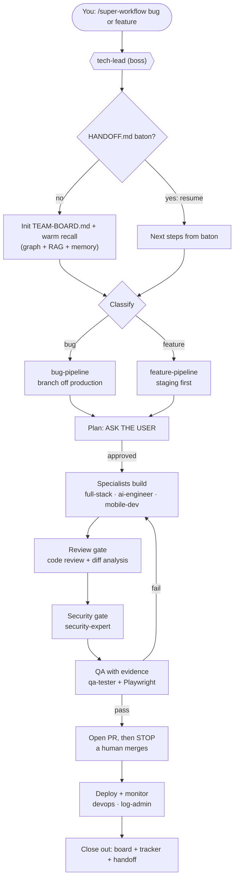

<h1 align="center">🎻 claude-super-workflow</h1>

<p align="center">
  <b>A 13-role AI engineering team for <a href="https://claude.com/claude-code">Claude Code</a>, run by a tech-lead that plans, asks, delegates, gates and ships.</b>
</p>

<p align="center">
  <a href="LICENSE"></a>
  
  
  <a href="https://github.com/Shadysmetools/claude-super-workflow/stargazers"></a>
</p>

<p align="center">
  
</p>

> One command. A boss agent reads your project, warms its memory, shows you a plan and **waits for your go**. Then specialists build, review, secure, QA, deploy and monitor, all talking through a shared blackboard. Long missions run hands-off as a self-pacing loop that parks anything a human should decide.

<p align="center">
  <b>🚀 New here? → <a href="docs/QUICKSTART.md">60-Second Quick Start</a></b> &nbsp;·&nbsp; ⭐ If this saves you from herding a dozen one-off subagents, drop a star.
</p>

---

## ⚡ 60-second install

```bash
# 1. Add this repo as a plugin marketplace
claude plugin marketplace add Shadysmetools/claude-super-workflow

# 2. Install
claude plugin install super-workflow@claude-super-workflow

# 3. Restart Claude Code, then:
/super-workflow feature "add a dark-mode toggle to settings"
```

Optional (30 more seconds): copy [`.superworkflow.example.json`](.superworkflow.example.json) into your project root as `.superworkflow.json` and fill in your branch names, URLs, review tools and human gates. Without it the team runs in **generic mode** and learns your conventions from your `CLAUDE.md` / README.

---

## 🆕 What's new in v1.2

| | |
|---|---|
| 🔁 **Loop engine**: `/super-workflow:loop` | Run epics, multi-bug sweeps and migrations **across sessions, hands-off**. Each firing resumes the baton, ships ONE bounded slice, rewrites the baton and self-paces via `/loop`. Safe work ships automatically; production merges, pricing, brand, destructive and outward-facing actions are **parked** for you. |
| ▶️ **Resume-first entry** | `/super-workflow` checks for an unfinished `HANDOFF.md` baton before anything else and continues it, without clobbering a different mission's baton. |
| 🪙 **`/super-workflow:handoff` ships** | The token-baton command the README always promised now exists, with *Parked / needs human* and *Loop state* sections. |
| 🧭 **Project-aware boot** | A `.superworkflow.json` (branches, environments, gates, human gates, tracker, `rulesFile`, `contextFiles`) is found by walking up from the session folder and injected at token-zero. No more hand-editing pipeline placeholders. |
| 📊 **Live usage status line** | Real `context_window` and 5-hour / 7-day plan-usage gauges, a 256k baton gauge, cost and duration. Optional wrong-account guard via `SUPERWF_EXPECTED_ACCOUNT`. |
| 🎭 **Playwright-first QA** | qa-tester drives Playwright MCP over the accessibility tree: deterministic, cheap on context, and cross-browser, with a real browser as fallback. |
| 🧠 **Two new expert skills** | `claude-architecture` (which Claude Code surface fits: hook vs skill vs subagent vs MCP, plus a setup audit) is preloaded into the context expert. `claude-design` (routes between design skills) is preloaded into the designer. |
| 📌 **"Pointers, not copies" gates** | The tech-lead never states a branch or gate from memory; it reads your canonical `rulesFile`. Sweeps are batched by area, never one PR per bug. |
| 🐛 **Fixes** | The token-watch hook now reads `transcript_path` from the hook payload, so it actually fires. Template context files are skipped instead of burning tokens every session. |

---

## How it works



Feature work merges to **staging** after a lightweight gate, gets QA'd live, then promotes to production **by cherry-pick only** with the full gate on the promotion PR. Any **HIGH**, **auth / cross-tenant**, or **data-correctness** finding blocks the merge.

---

## The commands

| Command | What it does |
|---|---|
| `/super-workflow [bug\|feature] <description>` | Main entry. Resumes a baton or routes to the right pipeline and drives the team. Omit the type and it asks. |
| `/loop /super-workflow:loop <mission>` | **New.** Hands-off multi-session mission: one bounded slice per firing, parks human decisions. |
| `/super-workflow:handoff` | Writes the **token-baton** so a fresh session resumes with zero loss. |
| `/super-workflow:saas-refresh` | Browses your tracked competitors and refreshes the competitive snapshot. |
| `update me` | Tech-lead replies in **caveman mode**: terse status with roughly 75% fewer tokens. |

---

## The 13 roles

| Role | Owns |
|---|---|
| **tech-lead** (boss) | Orchestration, decisions, plan-gate, message bus, the blackboard, the loop mandate. |
| **ai-pm** | Specs, prioritization, acceptance criteria, vision linkage. Read-only on code. |
| **ai-engineer** | LLMs, embeddings, vector search, RAG, prompts, prompt-injection defense. |
| **full-stack** | Frontend + backend: UI, hooks, routes, services, CI. Tenancy-aware queries. |
| **mobile-dev** | React Native / Expo, native builds, OTA, device QA, web parity. |
| **platform-engineer** | Architecture, scaling, data modeling, migration ordering, perf budgets. |
| **devops** | Deploys, process managers, CI/CD, secrets, hosting config. |
| **designer** | Competitive UX research, flows, design-system fit (preloads `claude-design`). |
| **qa-tester** | Evidence-based QA via Playwright MCP + real browser. No sign-off without proof. |
| **security-expert** | Auth, access control, secrets, input + prompt security, the security gate. |
| **log-admin** | Watches logs, CI, deploy and review bots; finds the root-cause line. |
| **project-coordinator** | Keeps the board and tracker honest, tracks blockers, maintains the baton. |
| **claude-context-expert** | Claude Code surfaces, context engineering, setup audits (preloads `claude-architecture`). |

---

## Configure it for your project

Drop a `.superworkflow.json` in your repo root (every field optional):

```jsonc
{
  "name": "My App",
  "branches": { "production": "main", "staging": "staging" },
  "environments": { "staging": "https://staging.example.com" },
  "gates": { "codeReview": "your PR review bot", "diffAnalysis": "your diff tool", "securityReview": "/security-review" },
  "humanGates": ["merge to production", "pricing / billing", "new external integration"],
  "tracker": "GitHub Issues",
  "rulesFile": ".claude/rules/team-operating-model.md",   // the ONE canonical rules file
  "contextFiles": ["docs/VISION.md", "docs/architecture/CODEBASE-MAP.md"]
}
```

The SessionStart hook finds it by walking up from the session folder, injects a short summary plus every `contextFiles` entry, and the pipelines and the loop's park list read their branch names and gates from it. See the full template in [`.superworkflow.example.json`](.superworkflow.example.json).

---

## How the agents communicate

Claude Code subagents are **hub-and-spoke**: they can't talk to each other and they forget context between spawns. This plugin builds a team out of four mechanisms:

1. **Tech-lead message bus.** Every role reports to the tech-lead, who relays.
2. **`SendMessage`.** Resume a role *with its context* for real back-and-forth (reviewer → dev → reviewer).
3. **`Workflow` tool.** Deterministic parallel fan-out; structured outputs feed the next stage.
4. **`TEAM-BOARD.md` + durable recall.** Knowledge graph + RAG + cross-session memory. Every role **reads it first** and **posts after**.

Recall plugins such as context-mode, claude-mem and a graph skill are **optional**. The team works without them; recall is just shallower.

---

## Session ritual: the team "levels up" every session

A `SessionStart` hook injects, at token-zero: the team contract, your `.superworkflow.json` summary and `contextFiles`, and the plugin's `context/` files once you fill them in (`VISION.md`, `CURRENT-SAAS.md`, `SKILL-DELTAS.md`). Append a dated bullet to `SKILL-DELTAS.md` whenever a role learns something reusable, and it becomes standing context. v1.2 ships with a few hard-won generic ones, such as fingerprinting the failure set before theorizing and using pointers rather than copies for rules.

---

## ⚙️ Recommended settings

```jsonc
{
  "effortLevel": "xhigh",          // deepest reasoning for planning
  "alwaysThinkingEnabled": true,
  "autoCompactWindow": 256000,
  "statusLine": {                  // ⚡ model ▸ folder | ctx | 256k | 5h | 7d | $cost | time
    "type": "command",
    "command": "node \"<path-to-plugin>/scripts/statusline.cjs\"",
    "refreshInterval": 60
  }
}
```

The status line shows how close you are to the baton threshold. Near it, run `/super-workflow:handoff`. Full rationale → **[docs/SETTINGS.md](docs/SETTINGS.md)**.

---

## 🎙️ Voice dictation (bonus)

Tap a hotkey, speak in **any language**, and clean English text is pasted at your cursor (Groq Whisper, translate mode). See [`scripts/voice/README.md`](scripts/voice/README.md).

---

## Repo layout

```
.claude-plugin/              plugin.json + marketplace.json
.superworkflow.example.json  per-project config template
agents/                      the 13 role definitions
commands/                    /super-workflow, loop, handoff, saas-refresh
skills/                      bug-pipeline, feature-pipeline, team-blackboard, team-orchestra,
                             graphify-team, claude-architecture, claude-design
hooks/                       session-start, prompt-hook, precompact (+ hooks.json)
context/                     VISION / CURRENT-SAAS / SKILL-DELTAS
scripts/                     statusline.cjs, voice/ (hotkey dictation)
docs/                        QUICKSTART, GUIDANCE, SETTINGS
```

---

## 🤝 Built alongside Knowcap

This workflow was forged building [**Knowcap**](https://knowcap.ai), *the trust layer for AI agents: every fact an agent acts on is confirmed by a named human, with a full audit trail.*

The two fit together naturally: **Knowcap is where your team's confirmed facts live** (from meetings, docs and chat), and this workflow is **the AI team that acts on them**. If you want your agents working from facts a human has actually verified, not just whatever they scraped, point them at Knowcap via its MCP server.

> 👉 Learn more / try it: **[knowcap.ai](https://knowcap.ai)**

*(This repo is a standalone, project-agnostic framework that works on its own. Knowcap is the recommended fact/memory layer behind it.)*

---

## Contributing

PRs welcome: new roles, new pipelines, better recall wiring, non-Windows voice launchers. Read [CONTRIBUTING.md](CONTRIBUTING.md) first. Security issues → [SECURITY.md](SECURITY.md).

## License

[MIT](LICENSE) © 2026 Shady (@Shadysmetools)

---

<p align="center"><sub>Built with Claude Code. If it helped, a ⭐ goes a long way.</sub></p>

---

**Built by [Shady Al-Halawani](https://github.com/Shadysmetools)**, AI Product Manager & Tech Lead · [LinkedIn](https://www.linkedin.com/in/shady-al-halawani-333a5419a) · [Book a call](https://calendly.com/shady-al-halawani)
